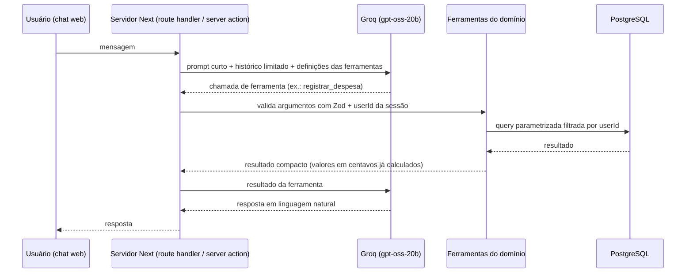

# Código e arquitetura

## Stack efetiva

| Peça | Versão | Observação |
|---|---|---|
| Next.js (App Router) | 16.4.1 | `create-next-app` estável; Turbopack padrão |
| React / React DOM | 19.3.0 | |
| TypeScript | 5.9.3 | `strict`, alias `@/*` → `src/*` |
| Tailwind CSS | 4.3.3 | via `@tailwindcss/turbopack` |
| Drizzle ORM / drizzle-kit | 0.45.4 / 0.31.11 | dialeto PostgreSQL |
| pg | 8.23.1 | driver Node.js (exige runtime Node, não Edge) |
| Zod | 4.6.7 | ambiente e (futuramente) entradas das ferramentas da IA |
| Pino | 10.4.0 | logger do servidor com redação |
| Vitest | 5.0.4 | ambiente Node |
| Node.js / pnpm | 24.11 / 12.11.2 | `packageManager` fixado |

Versões exatas ficam em `pnpm-lock.yaml`.

## Mapa do código

```text
src/
├── app/                 # App Router: layout (pt-BR), página principal do chat e APIs
│   ├── api/chat/        # Route handler do chat com validação Zod e testes
│   ├── layout.tsx
│   └── page.tsx         # Página com layout do chat web conversacional
├── components/
│   └── chat/            # Componentes de apresentação da interface conversacional
│       ├── chat-container.tsx # Orquestrador de estado do chat (Client Component)
│       ├── chat-input.tsx     # Campo de texto, atalhos de teclado e envio acessível
│       ├── chat-messages.tsx  # Lista de mensagens, estado vazio com atalhos e loading
│       └── types.ts           # Tipos de mensagens e prompts rápidos
├── db/
│   ├── index.ts         # getDb(): pool pg limitado (max 5), lazy, reutilizado via globalThis
│   ├── index.test.ts    # ciclo de vida do pool (pg mockado)
│   └── schema/          # schema Drizzle: users, categories, transactions, goals
│       ├── users.ts
│       ├── categories.ts
│       ├── transactions.ts
│       ├── goals.ts
│       └── index.ts
├── features/
│   └── transactions/    # domínio de movimentações e cálculos em centavos
│       ├── money.ts     # utilitários determinísticos (parseAmountToCents, formatCentsToBrl)
│       ├── schemas.ts   # validação com Zod das entradas
│       ├── service.ts   # registerExpense, registerIncome, calculateBalance, getBalance
│       └── transactions.test.ts # testes unitários e de isolamento de usuário
└── lib/
    ├── env-schema.ts    # schemas Zod de ambiente (sem server-only, usado pelo drizzle.config)
    ├── env.ts           # leitura validada de DATABASE_URL e LOG_LEVEL (server-only)
    ├── logger.ts        # Pino com redação de segredos (server-only)
    ├── utils.ts         # cn() = clsx + tailwind-merge
    └── *.test.ts        # testes de fronteira sem credenciais
drizzle/                 # SQL de migrations versionadas (0000_loud_ezekiel.sql)
eslint-rules/            # regras locais (max-lines, console, fronteira de dados) e base Next
scripts/verify-quality-rules.mjs  # self-check das regras locais
drizzle.config.ts        # schema → ./drizzle; credenciais só se houver URL
vitest.config.mts
```

## Fronteiras e fluxo

Implementado hoje:
- Infraestrutura servidor, schema de dados com migrations geradas e o módulo de domínio `src/features/transactions/` com validações Zod e cálculos determinísticos em centavos testados com Vitest.
- Interface web do chat funcional em `src/components/chat/` e `src/app/page.tsx`, consumindo a API `/api/chat` com validação Zod e sugestões rápidas de uso no estado vazio.

Fluxo planejado (não implementado) do chat, conforme `PRODUCT.md`:



Regras de fronteira:

- `src/app` e `src/components` não importam `@/db` (regra `quality/no-direct-data-access`). Eles chamam módulos de domínio.
- O `userId` vem sempre da sessão no servidor, nunca dos argumentos gerados pelo modelo.
- O provedor de IA ficará atrás de uma interface própria (ex.: `src/lib/ai/`) para permitir troca de modelo/provedor.

## Dados e migrations

- Schema em `src/db/schema/` com tabelas `users`, `categories`, `transactions` e `goals`. Tipos inferidos via `$inferSelect`/`$inferInsert`.
- Migration inicial `drizzle/0000_loud_ezekiel.sql` gerada com sucesso.
- Dinheiro em centavos (`integer`), nunca `real`/`double`.
- `pnpm db:generate` gera SQL em `drizzle/` sem conectar; revise o diff. `pnpm db:migrate` usa `DATABASE_URL_UNPOOLED` ou `DATABASE_URL` e só deve rodar em banco autorizado. Sem `db:push`, sem migration no build ou por request.
- Pool: `max: 5`, `connectionTimeoutMillis: 5000`, `idleTimeoutMillis: 30000`; erros ociosos logados só com `code`.

## Decisões

| Decisão | Motivo | Fonte / data | Revisar quando |
|---|---|---|---|
| Drizzle + PostgreSQL + `pg` | Pedido do produto e default do toolkit | toolkit `f13bb35`, 2026-10-15 | Host exigir Edge/driver HTTP |
| `typecheck` = `next typegen && tsc --noEmit` | `LayoutProps`/`PageProps` são tipos globais gerados por `next dev/build/typegen`; sem eles o `tsc` falha num clone limpo | `node_modules/next/dist/docs/01-app/03-api-reference/03-file-conventions/layout.md`, 2026-10-15 | Next mudar a geração de tipos |
| `@types/node@^24` | Alinhar ao runtime Node 24 (o scaffold trouxe `^20`) | toolkit `docs/04-project-bootstrap.md` | Mudança de runtime |
| `esbuild` em `allowBuilds` do pnpm | pnpm 12 bloqueia scripts de build por padrão; esbuild é usado por drizzle-kit/vitest | log do `pnpm add`, 2026-10-15 | Ferramentas deixarem de depender do postinstall |
| IA atrás de interface própria, Groq `openai/gpt-oss-20b` | Restrição do produto: trocar modelo sem reescrever | `PRODUCT.md` | Limites/custos do plano gratuito |

## Manutenção

Atualize este mapa ao alterar diretórios, dependências relevantes, contratos ou fronteiras. Registre comportamento comprovado; remova decisões que deixaram de valer.
